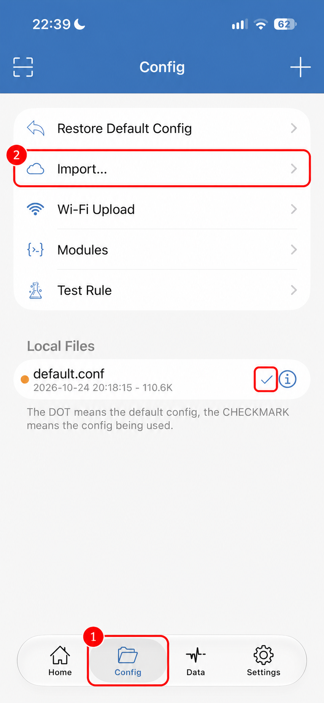
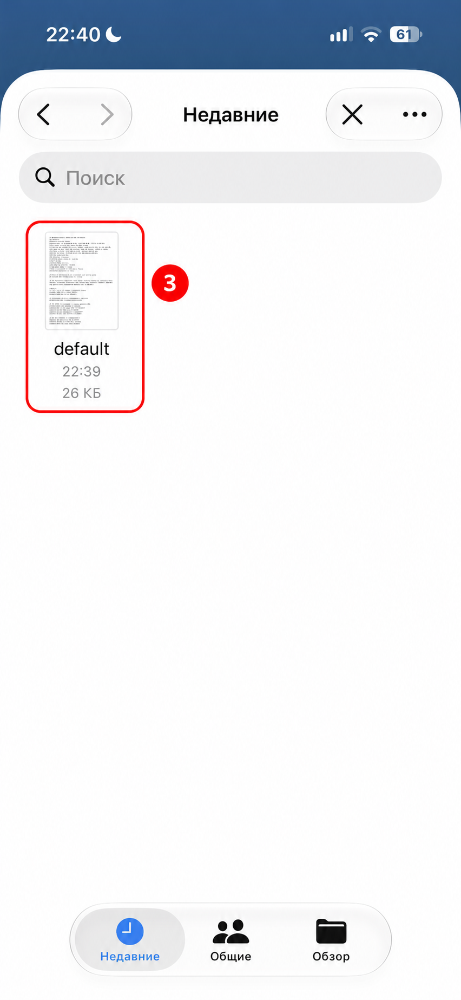
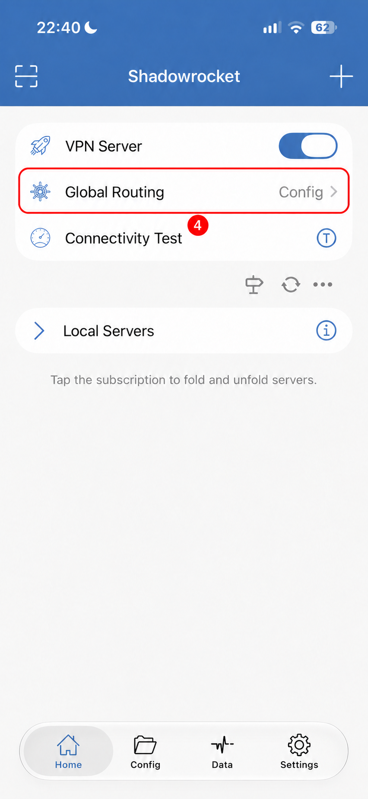

# Shadowrocket: импорт конфигурации

[← О проекте](../../README.md) · [Файл default.conf](default.conf) · [Скачать конфигурацию](https://raw.githubusercontent.com/theRomansky/split-tunneling-rules/main/main/shadowrocket/default.conf)

`default.conf` — готовая конфигурация Shadowrocket для раздельного туннелирования. Выбранные сервисы направляются напрямую (`DIRECT`), а остальной трафик — через выбранный VPN-сервер согласно правилам, включая завершающий `FINAL,PROXY`. В файле также есть общие настройки, DNS, локальные исключения и URL Rewrite.

VPN-сервер нужно добавить отдельно: этот файл не содержит серверов и данных для подключения. Перед импортом сохраните копию своей конфигурации, особенно если она тоже называется `default.conf`.

## 1. Сохраните файл в «Файлы»

На iPhone откройте [прямую ссылку на default.conf](https://raw.githubusercontent.com/theRomansky/split-tunneling-rules/main/main/shadowrocket/default.conf) и сохраните файл в приложение **«Файлы»**, например в «Загрузки». Если браузер показывает текст, используйте меню «Поделиться» → «Сохранить в Файлы», если этот пункт доступен.

Сохраняйте сам файл `default.conf`, а не HTML-страницу GitHub. Запомните выбранную папку. Экран сохранения зависит от браузера и на иллюстрациях ниже не показан.

## 2. Откройте Config и нажмите Import…

В Shadowrocket перейдите на вкладку **Config** внизу экрана — отметка **1**. Затем нажмите **Import…** — отметка **2**. Откроется системный выбор файла iOS.

## 3. Выберите сохранённый файл

В открывшемся окне «Файлы» нажмите на сохранённый **default.conf** — отметка **3**. На скриншоте он показан в разделе «Недавние» под именем **default**, без отображения расширения.

Если файла нет в «Недавних», перейдите в **«Обзор»** и откройте папку, куда вы его сохранили. Это выбор файла в приложении «Файлы», а не раздел Settings в Shadowrocket.

После импорта вернитесь в **Config** и убедитесь, что у нужной конфигурации в **Local Files** стоит синяя галочка. На первом скриншоте она выделена справа от `default.conf`. Если галочки нет, выберите импортированную конфигурацию и активируйте её в меню файла. Меню активации на предоставленных скриншотах не показано.

Оранжевая точка означает конфигурацию по умолчанию, а **галочка — конфигурацию, которая сейчас используется**. Дата и размер на иллюстрации приведены как пример: у вашей копии они могут отличаться.

## 4. Проверьте Global Routing

Перейдите на вкладку **Home**. В строке **Global Routing** должно быть выбрано **Config** — отметка **4**. Если выбран другой режим, откройте эту строку и выберите Config.

Название подключения на иллюстрации заменено на нейтральное `VPN Server`. Используйте собственный настроенный сервер.

Переподключите VPN, полностью перезапустите нужное приложение и проверьте его работу. При необходимости посмотрите в журнале соединений Shadowrocket, какое правило применяется к проблемному домену.

## Обновление и возврат к прежним настройкам

При изменении правил в репозитории скачайте свежий `default.conf` и повторите импорт. Локальный файл, импортированный через «Файлы», сам не обновится после изменения репозитория. Перед заменой сохраните собственные правки отдельно.

Если после импорта возникли проблемы, выберите сохранённую прежнюю конфигурацию в Config и переподключитесь. Проверьте, что галочка стоит у неё.

## Что учитывать

- `DIRECT` использует IP текущей сети и сам по себе не обеспечивает российский адрес при нахождении за границей.
- Выбор активного файла и выбор режима Global Routing — отдельные действия; проверьте оба.
- Инструкция составлена по скриншотам автора от 24 октября 2026 года. Версия приложения не указана; названия и расположение элементов в других версиях могут отличаться.
- Красные рамки и номера добавлены к скриншотам для пояснения шагов и не являются частью интерфейса приложения.
